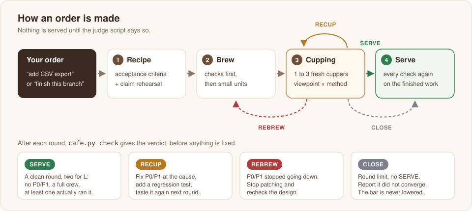
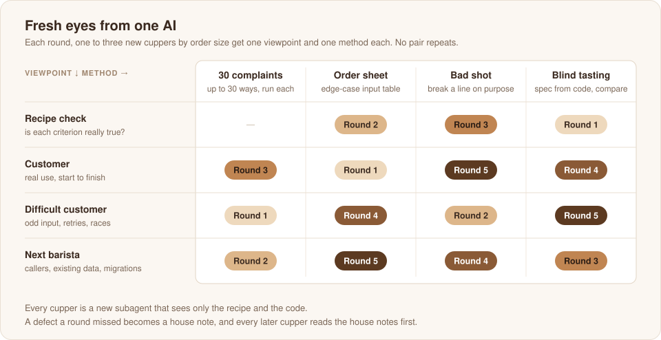
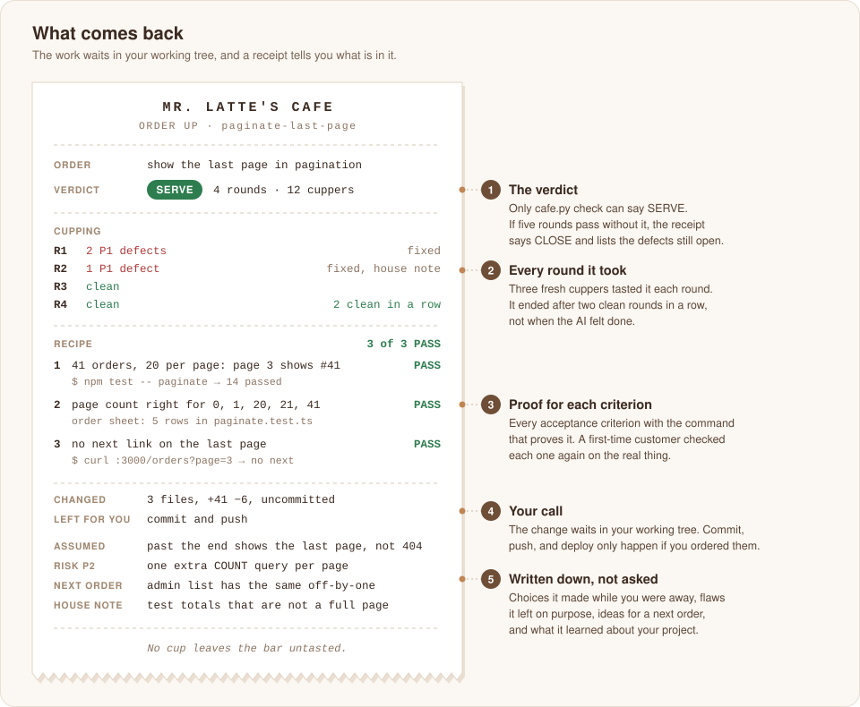

# cafe-skills

<p align="center">
  
</p>

<p align="center">
  <b>No cup leaves the bar untasted.</b><br>
  맛보지 않은 잔은 손님에게 나가지 않습니다.
</p>

[English](#english) · [한국어](#한국어)

---

## English

Mr. Latte's cafe for **Claude Code, Codex, and Grok**. One workflow, one judge. Place an **order**, and it comes back with changes and verification evidence.

### order

**Hand off a task with a clear finish line.** A bug fix, a feature, a refactor, or a branch to finish: `order` implements it and, with full verification available, keeps reviewing until the judge says it is ready. The tasting is sized to the order, so a small fix gets a small one. If it is not ready by its round limit, it reports any remaining defects. If the host lacks the required tools, it returns an UNVERIFIED handoff instead.

AI-built work has a familiar loop. You review it and find problems. You fix them and review again, and find new ones. You ask another AI and it finds still others. `order` is built to end that loop.

| Why the loop never ends | What `order` does |
|---|---|
| The bar is never fixed, so every reviewer invents their own. | Writes the acceptance criteria down before any code. Every review and the final check use that one bar. |
| A review picks the few problems that stand out. | Each round, fresh cuppers each take one viewpoint and one method from a fixed table, and run what they suspect instead of only reading. |
| A fix in one place breaks another. | Every fix gets a regression test and is tasted again by new cuppers. The work ends only after a clean round on the finished code, two in a row for a large order. |

**What you get**

- **Finished means finished.** Only `cafe.py check` can end the work, not the AI's own sense of being done. If the work does not converge within its round limit, the report says so.
- **Sized to the order.** A one-file fix gets one cupper a round. A feature across layers gets three. The judge script holds each order to its size.
- **You can see where it is.** Each step prints one line that starts with the skill version, such as `[cafe v0.2.2 3/4 Cupping R1] 1 cupper tasting: Customer x Order sheet`, and the steps show up in the host's task list or plan.
- **Evidence, not opinions.** A finding counts only with a command and its output, a failing test, or the line and the criterion it breaks.
- **A second opinion without a second AI.** Fresh subagents with new viewpoints and methods do what another AI would.
- **Fewer interruptions.** Ordinary choices become written assumptions. Host approval requirements still apply. It pushes, deploys, or deletes data only when your order says so and verification passes.
- **It learns your project.** Every defect a round missed becomes a house note that later reviews read first.

**What to order.** A bug fix, a feature, a refactor, tests, docs, or a branch to finish.

**How big a tasting.** Before the recipe, `order` sizes the work by the change it expects. A change that touches stored data, auth, money, deleting user data, or concurrency moves up one size.

| | S | M | L |
|---|---|---|---|
| The change | up to 2 files, about 60 lines | up to about 6 files, 300 lines | bigger |
| Acceptance criteria | up to 3 | up to 6 | as many as the goal needs |
| Cuppers a round | 1 | 2 | 3 |
| Clean rounds to serve | 1 | 1 | 2 in a row |
| Round limit | 3 | 4 | 5 |
| Fresh subagents in all | 1 to 3 | 3 to 9 | 8 to 17 |

A small order costs about as much as one review. A large one costs more, and in exchange you do not review it round after round. To keep the cost down, cuppers run on Sonnet in Claude Code (on the configured model in other hosts) with a budget of tool calls, and run the narrowest check that proves each point.

#### How it works

<p align="center">
  
</p>

| Step | What happens |
|---|---|
| 1. Recipe | Fix the acceptance criteria and the non-goals before any code. A claim rehearsal asks "this shipped and a customer complained. Why?" and adds to the recipe only what would break the goal in real use. Open choices become written assumptions, so it never stops to ask. |
| 2. Brew | Build the checks first, then build in small units, each one checked before the next. |
| 3. Cupping | Each round, fresh cuppers review independently: one, two, or three by size. Each gets one viewpoint and one method from a fixed table, and a budget of tool calls. Only defects with evidence survive. `cafe.py check` judges the round before any fix, so no untasted fix goes out. Each P0 and P1 is fixed at its cause, and a regression test is added. |
| 4. Serve | Every acceptance check runs again on the finished work. A large order also gets a first-time customer, a new agent that never saw the work, who verifies each criterion on the real thing and rechecks every finding the barista dropped. |

**Fresh eyes with one AI.** Use any supported host with independent subagents. Fresh context and different review angles do not require switching model providers:

<p align="center">
  
</p>

- **Fresh cuppers.** Each cupper is a new subagent that sees only the recipe and the code, not your conversation.
- **Viewpoints.** Recipe check, customer, difficult customer, and next barista.
- **Methods.** 30 complaints (list ways it could fail in real use, up to 5, 10, or 30 by size, then run each), order sheet (a table of edge-case inputs to run), bad shot (break a line on purpose and see if a check catches it), and blind tasting (write a spec from the code alone, then compare it with the recipe).
- **House notes.** Each defect a round missed adds a line to `.cafe/house-notes.md`. Every later cupper reads that file first.

**When it ends.** A clean round has the size's full set of cuppers, at least one cupper that actually ran something, and no P0 or P1 defects. S and M serve after one clean round, L after two in a row. P0 and P1 count only what can happen in real use, so the bar does not creep toward contrived cases. Changing the recipe resets the count, so a late change can end in CLOSE. If serious defects stop going down, the verdict is REBREW, which means stop patching and recheck the design. At the round limit (3, 4, or 5 by size) the verdict is CLOSE, and the report says the work did not converge. Ordering the same goal again after CLOSE starts a new order with a fresh round limit, and the defects still open become its acceptance criteria.

### Install

Requires Python 3 and a coding host with project access. Full verification also requires independent subagents and the project's check tools. No Python packages or additional API keys are needed by the skill itself.

**Claude Code plugin:**

```
/plugin marketplace add jongha/cafe-skills
/plugin install cafe@cafe-skills
```

**Turn on auto-update.** Claude Code leaves auto-update off for marketplaces outside Anthropic. Run `/plugin`, open **Marketplaces**, select `cafe-skills`, and choose **Enable auto-update**. Claude Code then checks for a new version soon after a session starts, and the update loads with `/reload-plugins` or the next launch. To update right away, or if you installed before auto-update was on, choose **Update marketplace** on the same screen. It fetches the latest listing and updates `cafe`. From a shell, run `claude plugin marketplace update cafe-skills`, then `claude plugin update cafe@cafe-skills`.

**Standalone skill** — clone this repository, then choose your host:

```sh
git clone https://github.com/jongha/cafe-skills.git
cd cafe-skills
python3 scripts/install.py codex
# Or: python3 scripts/install.py grok
# Or: python3 scripts/install.py claude
```

| Host | Default skill folder | Invocation |
|---|---|---|
| Codex | `~/.agents/skills/order/` | `$order <task>` |
| Grok Build / CLI | `~/.grok/skills/order/` | `/order <task>` or `/skills order` |
| Claude Code standalone | `~/.claude/skills/order/` | `/order <task>` |
| Claude Code plugin | Managed by Claude | `/cafe:order <task>` |

The installer links `order/` to this clone instead of copying it, so `git pull` in the clone updates the skill. Codex and Claude Code pick up the change on their own; in Grok, start a new session if it does not show. Keep the clone where it is. The installer never replaces an existing `order/` that is not its own link. Choose either the Claude plugin or the standalone installation, so the command does not appear twice.

For a project installation, use `--skills-dir /path/to/project/.agents/skills` for Codex, `.grok/skills` for Grok, or `.claude/skills` for Claude. Grok skips project skill folders that git ignores.

Grok also loads Claude Code skills and installed Claude plugins, so if you already use the Claude plugin, Grok can use `order` without another install. When two skills share a name, Grok keeps the one from the higher-priority location.

### Use

Codex:

```text
$order fix the missing last page in pagination
$order add CSV export to the orders page
$order finish this branch and push it
```

Claude Code plugin:

```
/cafe:order fix the missing last page in pagination
/cafe:order add CSV export to the orders page
/cafe:order finish this branch and push it
```

Grok CLI or Claude Code standalone:

```text
/order fix the missing last page in pagination
```

`order` keeps its work in `.cafe/` at the project root. Each order gets a folder with `recipe.md`, `cupping.tsv`, and `scratch/`. Order folders stay out of git. `house-notes.md` is shared across orders, and you can commit it for your team. If a run stops midway, give the same order again and it continues where it stopped.

**Before you walk away.** Hosts still ask before commands they have not been allowed to run. In Claude Code, use auto mode, or allow your build and test commands with `/permissions`, so the run does not wait on a prompt. In Codex and Grok, allow them in that host's settings. The skill never bypasses a sandbox or an approval prompt. The result stays uncommitted unless your order asks for a commit or a push. If your CLAUDE.md or AGENTS.md limits subagents or local builds and tests, `order` follows it, for example by running cuppers one after another.

### What comes back

<p align="center">
  
</p>

The change waits in your working tree, uncommitted unless your order asked for a commit. With it comes a receipt in your terminal: the verdict and the rounds it took, each acceptance criterion with the command that proves it, what changed, what is left for you, the choices it made instead of asking, the risks it left, ideas for a next order, and new house notes. If the round limit passes without SERVE, the receipt says CLOSE and lists each defect still open with its repro command.

### Files

```
skills/order/SKILL.md          the workflow
skills/order/cupping.md        cupping table, viewpoints, methods, cupper brief
skills/order/scripts/cafe.py   cupping notes and the verdict (python3, no dependencies)
skills/order/references/       host notes and limited verification
skills/order/agents/           Codex metadata and invocation policy
scripts/install.py             links the skill into a host's skill folder
tests/test_install.py          installation checks
assets/                        images for this README
```

From a clone of this repo, run `python3 skills/order/scripts/cafe.py self-test` to check the verdict rules and `python3 -m unittest discover -s tests -v` to check installations.

Host conventions: [Codex skills](https://learn.chatgpt.com/docs/build-skills), [Claude Code skills](https://code.claude.com/docs/en/skills), [Grok skills and subagents](https://github.com/xai-org/grok-build/blob/main/crates/codegen/xai-grok-shell/README.md#skills).

### License

MIT

---

## 한국어

**Claude Code, Codex, Grok**에서 쓰는 Mr. Latte의 카페입니다. 같은 작업 지침과 판정 스크립트를 사용합니다. **order**로 주문하면 변경한 결과와 검증 근거를 돌려받습니다.

### order

**완료 기준을 정하고 작업을 맡깁니다.** 버그 수정, 기능 추가, 리팩터링, 브랜치 마무리 등을 구현하고, 전체 검증이 가능한 환경에서는 판정 스크립트가 준비됐다고 할 때까지 리뷰합니다. 맛보는 양은 주문 크기에 맞추므로, 작은 수정은 짧게 맛보고 끝납니다. 라운드 한도를 채우고도 문제가 남으면 그대로 보고합니다. 필요한 도구가 없는 환경에서는 UNVERIFIED(미검증)로 결과를 넘깁니다.

AI로 만든 결과물은 리뷰할 때마다 새 문제가 나옵니다. 고치고 다시 보면 또 나오고, 다른 AI에게 맡기면 또 다른 문제가 나옵니다. `order`는 이 반복을 끝내려고 만들었습니다.

| 반복이 끝나지 않는 이유 | `order`가 하는 일 |
|---|---|
| 기준이 고정돼 있지 않아 리뷰어마다 기준을 새로 만듭니다 | 코드를 쓰기 전에 수용 기준을 적어 둡니다. 모든 리뷰와 마지막 확인이 이 기준 하나를 씁니다 |
| 리뷰가 눈에 띄는 몇 개만 집습니다 | 라운드마다 새 커퍼가 정해진 표에서 관점과 방법을 하나씩 받아, 읽기만 하지 않고 의심 가는 것을 직접 돌려 봅니다 |
| 한 곳을 고치면 다른 곳이 깨집니다 | 수정마다 회귀 테스트를 더하고, 새 커퍼가 다시 맛봅니다. 마지막 코드로 깨끗한 라운드가 나와야 작업이 끝나고, 큰 주문은 연속 두 번이어야 합니다 |

**좋은 점**

- **끝났다고 하면 정말 끝난 것입니다.** 작업을 끝내는 것은 AI의 느낌이 아니라 `cafe.py check`입니다. 라운드 한도 안에 수렴하지 않으면 그렇다고 보고합니다.
- **주문 크기만큼만 맛봅니다.** 파일 하나를 고치는 주문은 라운드마다 커퍼가 하나이고, 여러 층에 걸친 기능은 셋입니다. 판정 스크립트가 주문마다 정한 크기를 지킵니다.
- **지금 어디쯤인지 보입니다.** 단계마다 스킬 버전으로 시작하는 `[cafe v0.2.2 3/4 커핑 R1] 커퍼 1명 맛보는 중: 손님 x 주문표` 같은 한 줄을 남기고, 도구의 작업 목록에도 단계가 뜹니다.
- **의견이 아니라 증거만 남습니다.** 명령과 출력, 실패하는 테스트, 또는 어긴 수용 기준과 코드 위치가 있어야 지적으로 인정합니다.
- **AI 하나로 두 번째 의견을 얻습니다.** 새 관점과 방법을 받은 새 서브에이전트가 다른 AI의 몫을 합니다.
- **불필요한 질문을 줄입니다.** 일반적인 선택은 가정으로 적어 보고서에 남깁니다. 실행 환경의 승인 절차는 따릅니다. 푸시, 배포, 데이터 삭제는 주문에 적혀 있고 검증을 통과했을 때만 합니다.
- **쓸수록 프로젝트를 배웁니다.** 라운드가 놓친 디펙트는 하우스 노트가 되고, 이후의 리뷰가 먼저 읽습니다.

**무엇을 주문하나.** 버그 수정, 기능 추가, 리팩터링, 테스트, 문서, 브랜치 마무리 등을 맡길 수 있습니다.

**얼마나 맛보나.** 레시피를 쓰기 전에 예상하는 변경으로 주문 크기를 정합니다. 저장된 데이터, 인증, 돈, 사용자 데이터 삭제, 동시성을 건드리면 한 단계 올립니다.

| | S | M | L |
|---|---|---|---|
| 변경 | 파일 2개, 60줄 안팎까지 | 파일 6개, 300줄 안팎까지 | 그보다 큼 |
| 수용 기준 | 3개까지 | 6개까지 | 목표에 필요한 만큼 |
| 라운드마다 커퍼 | 1명 | 2명 | 3명 |
| 서빙에 필요한 깨끗한 라운드 | 1번 | 1번 | 연속 2번 |
| 라운드 한도 | 3 | 4 | 5 |
| 새 서브에이전트 전체 | 1~3번 | 3~9번 | 8~17번 |

작은 주문은 리뷰 한 번 값이면 되고, 큰 주문은 더 들지만 그 대신 리뷰를 몇 번이고 직접 반복하지 않아도 됩니다. 비용을 줄이려고 커퍼는 Claude Code에서 Sonnet으로(다른 도구에서는 설정된 모델) 돌고, 도구 호출 횟수에 상한이 있으며, 확인할 때마다 그 점을 증명하는 가장 좁은 명령만 돌립니다.

#### 작동 방식

<p align="center">
  
</p>

| 단계 | 하는 일 |
|---|---|
| 1. 레시피 | 코드를 쓰기 전에 수용 기준과 하지 않을 것을 고정합니다. 클레임 리허설에서 "손님에게 나간 뒤 클레임이 들어왔다. 왜인가"를 먼저 묻고, 실제 사용에서 목표를 깨는 것만 레시피에 더합니다. 열린 선택은 가정으로 적어 두고, 묻느라 멈추지 않습니다 |
| 2. 추출 | 확인 방법을 먼저 만듭니다. 그다음 작은 단위로 구현하고, 단위마다 확인합니다 |
| 3. 커핑 | 라운드마다 새 커퍼가 크기에 따라 1명, 2명, 3명씩 서로 모른 채 리뷰합니다. 커퍼마다 정해진 표에서 관점 하나와 방법 하나, 그리고 도구 호출 상한을 받습니다. 증거가 있는 디펙트만 남깁니다. 고치기 전에 `cafe.py check`가 라운드를 판정하므로, 아무도 맛보지 않은 수정은 나가지 않습니다. P0, P1 디펙트는 원인을 고치고 회귀 테스트를 더합니다 |
| 4. 서빙 | 완성된 결과로 수용 기준 확인을 모두 다시 돌립니다. 큰 주문은 과정을 본 적 없는 새 에이전트가 처음 온 손님이 되어, 수용 기준을 실물로 하나씩 확인하고 바리스타가 버린 지적도 다시 판정합니다 |

**AI 하나로 새 눈을 만듭니다.** 독립 서브에이전트를 지원하는 환경이면 됩니다. 모델 제공자를 바꾸지 않아도 새로운 맥락과 다른 관점으로 검토할 수 있습니다.

<p align="center">
  
</p>

- **새 커퍼.** 커퍼는 매번 새 서브에이전트입니다. 대화 내용은 보지 못하고 레시피와 코드만 받습니다.
- **관점.** 레시피 검수, 손님, 까다로운 손님, 다음 바리스타입니다.
- **방법.** 넷입니다.
  - 클레임 30개: 실제 사용에서 틀릴 수 있는 경우를 크기에 따라 5가지, 10가지, 30가지까지 뽑고 하나씩 돌려 봅니다.
  - 주문표: 경계 입력의 표를 만들어 칸마다 돌려 봅니다.
  - 망친 샷: 일부러 한 줄을 망가뜨리고 확인이 알아채는지 봅니다.
  - 블라인드 테이스팅: 레시피를 보지 않고 코드만으로 명세를 쓴 뒤 레시피와 견줍니다.
- **하우스 노트.** 라운드가 놓친 디펙트마다 `.cafe/house-notes.md`에 한 줄이 쌓입니다. 이후의 모든 커퍼가 이 파일을 먼저 읽습니다.

**언제 끝나나.** 깨끗한 라운드는 그 크기의 커퍼가 다 있고, 실제로 돌려 본 커퍼가 하나 이상이고, P0, P1 디펙트가 없는 라운드입니다. S와 M은 깨끗한 라운드 한 번, L은 연속 두 번이면 서빙합니다. P0, P1은 실제 사용에서 일어날 수 있는 것만 셉니다. 그래야 기준이 억지 사례 쪽으로 끝없이 올라가지 않습니다. 레시피를 고치면 처음부터 다시 셉니다. 그래서 늦게 고치면 CLOSE로 끝날 수 있습니다. 심각한 디펙트 수가 줄지 않으면 REBREW가 나옵니다. 땜질을 멈추고 설계를 다시 보라는 뜻입니다. 라운드 한도(크기에 따라 3, 4, 5)를 채우고도 끝나지 않으면 CLOSE가 나오고, 수렴하지 못했다고 그대로 보고합니다. CLOSE 뒤에 같은 목표를 다시 주문하면 새 주문으로 시작해 라운드 한도를 처음부터 다시 받고, 남은 디펙트는 그 주문의 수용 기준이 됩니다.

### 설치

Python 3와 프로젝트 파일에 접근할 수 있는 코딩 도구가 필요합니다. 전체 검증에는 독립 서브에이전트와 프로젝트의 테스트 도구도 필요합니다. 스킬 자체는 별도 Python 패키지나 추가 API 키를 요구하지 않습니다.

**Claude Code 플러그인:**

```
/plugin marketplace add jongha/cafe-skills
/plugin install cafe@cafe-skills
```

**자동 업데이트를 켜세요.** Claude Code는 Anthropic 밖의 마켓플레이스에 대해 자동 업데이트를 꺼 둡니다. `/plugin`을 실행해 **Marketplaces**에서 `cafe-skills`를 고르고 **Enable auto-update**를 선택하세요. 그러면 세션을 시작하고 얼마 뒤 새 버전을 확인하고, 업데이트는 `/reload-plugins`를 하거나 다음에 실행할 때 적용됩니다. 바로 업데이트하거나 자동 업데이트를 켜기 전에 설치했다면 같은 화면에서 **Update marketplace**를 고르세요. 최신 목록을 받아 `cafe`를 업데이트합니다. 셸에서는 `claude plugin marketplace update cafe-skills`, 이어서 `claude plugin update cafe@cafe-skills`를 실행합니다.

**개별 스킬**로 설치하려면 저장소를 클론한 뒤 사용할 도구를 선택합니다.

```sh
git clone https://github.com/jongha/cafe-skills.git
cd cafe-skills
python3 scripts/install.py codex
# Grok: python3 scripts/install.py grok
# Claude: python3 scripts/install.py claude
```

| 도구 | 기본 설치 폴더 | 호출 |
|---|---|---|
| Codex | `~/.agents/skills/order/` | `$order 작업 내용` |
| Grok Build / CLI | `~/.grok/skills/order/` | `/order 작업 내용` 또는 `/skills order` |
| Claude Code 개별 설치 | `~/.claude/skills/order/` | `/order 작업 내용` |
| Claude Code 플러그인 | Claude가 관리 | `/cafe:order 작업 내용` |

설치 스크립트는 `order/`를 복사하지 않고 이 클론에 링크합니다. 그래서 클론에서 `git pull`만 하면 스킬이 업데이트됩니다. Codex와 Claude Code는 바뀐 내용을 알아서 읽고, Grok은 보이지 않으면 새 세션을 시작하세요. 클론 폴더는 옮기지 마세요. 설치 스크립트는 자기가 만든 링크가 아닌 `order/`는 바꾸지 않습니다. Claude는 명령이 두 번 보이지 않도록 플러그인과 개별 설치 중 하나만 쓰세요.

프로젝트에 설치하려면 Codex는 `--skills-dir /프로젝트/경로/.agents/skills`, Grok은 `.grok/skills`, Claude는 `.claude/skills`를 지정합니다. Grok은 git에서 무시한 프로젝트 스킬 폴더를 읽지 않습니다.

Grok은 Claude Code 스킬과 설치된 Claude 플러그인도 읽습니다. 그래서 Claude 플러그인을 이미 쓰고 있다면 따로 설치하지 않아도 Grok에서 `order`를 쓸 수 있습니다. 이름이 같은 스킬이 여럿이면 Grok은 우선순위가 높은 위치의 것 하나만 씁니다.

### 사용

Codex:

```text
$order 페이지네이션에서 마지막 페이지가 빠지는 버그 고쳐줘
$order 주문 페이지에 CSV 내보내기 추가
$order 이 브랜치 마무리하고 푸시까지 해줘
```

Claude Code 플러그인:

```
/cafe:order 페이지네이션에서 마지막 페이지가 빠지는 버그 고쳐줘
/cafe:order 주문 페이지에 CSV 내보내기 추가
/cafe:order 이 브랜치 마무리하고 푸시까지 해줘
```

Grok CLI 또는 Claude Code 개별 설치:

```text
/order 페이지네이션에서 마지막 페이지가 빠지는 버그 고쳐줘
```

작업 기록은 프로젝트 루트의 `.cafe/`에 남습니다. 주문마다 폴더가 하나씩 생기고, 그 안에 `recipe.md`, `cupping.tsv`, `scratch/`가 들어갑니다. 주문 폴더는 git에서 뺍니다. `house-notes.md`는 모든 주문이 함께 쓰는 파일이라 팀과 나누도록 커밋해도 됩니다. 중간에 멈췄다면 같은 주문을 다시 내면 멈춘 곳부터 이어 갑니다.

**자리를 비우기 전에.** 도구는 아직 허용하지 않은 명령을 실행하기 전에 묻습니다. Claude Code에서는 auto mode를 쓰거나 `/permissions`로 빌드와 테스트 명령을 허용해 두어야 실행이 확인 창에서 멈추지 않습니다. Codex와 Grok에서는 각 도구의 설정에서 허용하세요. 스킬은 샌드박스나 승인 절차를 우회하지 않습니다. 결과는 커밋하지 않은 상태로 남습니다. 커밋이나 푸시는 주문에 적었을 때만 합니다. CLAUDE.md나 AGENTS.md가 서브에이전트나 로컬 빌드와 테스트를 제한하면 `order`는 그 규칙을 따릅니다. 이를테면 커퍼를 한 명씩 차례로 돌립니다.

### 돌려받는 것

<p align="center">
  
</p>

바뀐 내용은 작업 트리에 그대로 있고, 주문에 커밋을 적지 않았다면 커밋하지 않습니다. 함께 터미널에 영수증이 나옵니다. 판정과 걸린 라운드, 수용 기준마다 그것을 증명한 명령, 바뀐 파일, 사용자에게 남긴 일, 묻지 않고 정한 가정, 남겨 둔 위험, 다음 주문 거리, 새 하우스 노트가 들어갑니다. 라운드 한도를 채우고도 SERVE가 나오지 않으면 영수증에 CLOSE가 찍히고, 아직 열린 디펙트를 재현 명령과 함께 적습니다.

### 파일

```
skills/order/SKILL.md          흐름
skills/order/cupping.md        커핑 표, 관점, 방법, 커퍼 지시문
skills/order/scripts/cafe.py   커핑 노트 기록과 판정 (python3, 의존성 없음)
skills/order/references/       도구별 실행 안내와 제한된 환경의 검증
skills/order/agents/           Codex 표시 정보와 호출 정책
scripts/install.py             스킬을 도구의 스킬 폴더에 링크
tests/test_install.py          설치 검증
assets/                        이 README의 이미지
```

판정 규칙은 `python3 skills/order/scripts/cafe.py self-test`, 설치 동작은 `python3 -m unittest discover -s tests -v`로 확인합니다.

설치 규격: [Codex 스킬](https://learn.chatgpt.com/docs/build-skills), [Claude Code 스킬](https://code.claude.com/docs/en/skills), [Grok 스킬·서브에이전트](https://github.com/xai-org/grok-build/blob/main/crates/codegen/xai-grok-shell/README.md#skills).

### 라이선스

MIT
